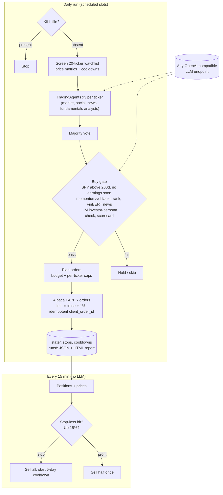

# agentic-paper-trader

[](https://github.com/rakshith-ponnappa/agentic-paper-trader/actions/workflows/ci.yml)

[](LICENSE)

A **guard-railed, multi-agent LLM paper trader**. Every trading day it screens a watchlist, asks the
[TradingAgents](https://github.com/TauricResearch/TradingAgents) multi-agent framework for a view on
each pick several times, takes the majority vote, and only buys once a set of deterministic checks
agree. It then rebalances a capped budget on an **Alpaca paper account**. A separate 15-minute
monitor enforces stop-losses and take-profits with no LLM involved.

> [!WARNING]
> **Paper trading only, not financial advice.** The code talks only to
> `https://paper-api.alpaca.markets` and contains no live-trading endpoint. It's an engineering
> project about putting LLM agents behind guardrails, not a strategy recommendation.

## Why it exists

LLM agents are persuasive but non-deterministic. This project explores a production pattern for
agentic systems: **let the model reason, but put votes, hard limits, cheap independent checks and
an off switch between it and any side effect.**

## How it works



## Safety by design

| Guardrail | Detail |
|---|---|
| Paper only | Hard-coded paper API base URL; there's no live endpoint to switch to. |
| Kill switch | If a `KILL` file exists in `$TA_HOME`, the trader and monitor exit immediately. |
| Budget caps | `AUTOTRADER_BUDGET_USD` (default 1000), a maximum of 10% per ticker, a maximum of 25 orders per run. |
| Drawdown brake | No new buys once unrealised loss passes 15% of the budget. |
| Ensemble vote | Each ticker is analysed 3 times; a single hallucinated "Buy" can't trade. |
| Deterministic gate | Market regime, earnings guard, factor rank and news sentiment must agree before a buy. |
| Bounded entries | Limit orders at the analysed close + 1%, which expire at the close. |
| Idempotent orders | `client_order_id = ta-<date>-<symbol>-<side>`. On an HTTP 422 duplicate, the existing order is fetched instead of a second one being placed. |
| One run per slot | A real run happens once per slot per day; reruns are dry. |
| Stops and cooldown | Default stop is 8% under entry. After a stop-out there's no re-buy for 5 days. |
| Secrets | Alpaca keys come from the environment or the macOS Keychain, and the LLM token from a file outside the repo. Nothing is committed. |

## Features

- **`autotrader.py`**: the daily loop (`--dry-run`, `--date`, `--all`, `--max-picks`, `--slot`, `--parallel`).
- **`monitor.py`**: stop-loss and take-profit guard; works even when the LLM endpoint is down.
- **`signals.py`**: the free checks (regime, earnings, factor scores, FinBERT), the LLM persona check, the scorecard and the gate logic.
- **`gate_backtest.py`**: replays the point-in-time gates over past decisions to see whether they would have helped.
- **`rescore.py`**: re-scores backtest decisions over several holding windows from prices only.
- **`hedge.py`**: screens candidates that moved least with (or against) a portfolio.
- **`advise.py`**: **advice-only** mode for your own holdings file; it never trades.
- **`deploy/launchd/`**: example macOS schedules for three daily slots and the 15-minute monitor.

## Tech stack

Python 3.11 · [TradingAgents](https://github.com/TauricResearch/TradingAgents) (LangGraph) · OpenAI-compatible
SDK · pandas · yfinance · FinBERT via Hugging Face transformers · Alpaca paper REST API · macOS launchd and
Keychain · pytest · GitHub Actions

## Quickstart

```bash
git clone https://github.com/rakshith-ponnappa/agentic-paper-trader.git
cd agentic-paper-trader
python3.11 -m venv .venv && source .venv/bin/activate
pip install -r requirements.txt

# LLM settings: any OpenAI-compatible endpoint (LiteLLM, vLLM, Ollama, a local gateway, ...)
cp examples/ta-env.example.sh ~/ta-env.sh   # edit it, and keep it outside the repo
export TA_ENV_FILE=~/ta-env.sh TA_PYTHON="$PWD/.venv/bin/python"
export ALPACA_KEY_ID=... ALPACA_SECRET_KEY=...   # PAPER keys from your Alpaca paper dashboard

scripts/run.sh --dry-run        # plans orders, submits nothing
scripts/monitor.sh              # one pass of the stop-loss/take-profit guard
python advise.py examples/holdings.example.json   # advice only
```

To schedule it, copy the files in `deploy/launchd/` to `~/Library/LaunchAgents/`, drop the
`.example` suffix, replace the `/path/to` placeholders, then `launchctl load` them.

### Configuration

| Variable | Used by | Purpose |
|---|---|---|
| `TA_HOME` | all | Where `runs/`, `state/`, `logs/`, `advice/` and `KILL` live (default: the repo root; all git-ignored) |
| `TA_PYTHON` | scripts | Python interpreter with the requirements installed |
| `TA_ENV_FILE` | scripts | Shell file exporting the LLM settings (see `examples/ta-env.example.sh`) |
| `TRADINGAGENTS_LLM_BACKEND_URL` | trader | OpenAI-compatible base URL |
| `OPENAI_API_KEY` | trader | Token for that endpoint |
| `TRADINGAGENTS_QUICK_THINK_LLM` / `TRADINGAGENTS_DEEP_THINK_LLM` | trader | Model names |
| `ALPACA_KEY_ID` / `ALPACA_SECRET_KEY` | trader, monitor | Alpaca **paper** keys (otherwise read from the Keychain) |
| `AUTOTRADER_BUDGET_USD` | trader | Total budget the bot may allocate (default `1000`) |
| `TA_GATEWAY_APP` | `run.sh` | Optional macOS app to launch if the LLM endpoint is down |

## Testing

```bash
pip install -r requirements-dev.txt
python -m pytest -q
```

The unit tests are offline: Alpaca, yfinance and the LLM are mocked or never called. They cover
order planning, budget caps, cooldowns, idempotent order retries, stop and take-profit decisions,
voting and the buy gate.

## Project layout

```text
autotrader.py      daily loop: screen -> vote -> gate -> plan -> paper orders
monitor.py         15-minute stop-loss / take-profit guard (no LLM)
signals.py         regime, earnings, factors, FinBERT, persona check, scorecard, gate
gate_backtest.py   point-in-time replay of the gates
rescore.py         price-only re-scoring of backtest decisions
hedge.py           low-correlation hedge screen
advise.py          advice-only analysis of a holdings file
scripts/           run.sh, monitor.sh, backtest.sh
deploy/launchd/    example macOS schedules
examples/          fake holdings file and env template
tests/             offline pytest suite
```

## Design decisions

- **Ensemble and gates instead of a smarter prompt.** Majority voting over independent runs cuts
  variance, and cheap deterministic checks catch obvious bad timing (bear regime, earnings week)
  that LLM analysts often argue past.
- **The LLM proposes, code disposes.** Sizing, caps, stops and order construction are plain Python
  and unit-tested; the model never builds orders itself.
- **No LLM in the risk path.** The stop-loss monitor depends only on prices, so a model outage
  can't stop it from protecting positions.
- **Measure the guardrails.** `gate_backtest.py` and `rescore.py` exist to check whether each gate
  actually improves outcomes, rather than assuming it does.

## Roadmap

- [ ] Containerise and run on a schedule in the cloud (Cloud Run Jobs or a Kubernetes CronJob) instead of launchd
- [ ] OpenTelemetry traces and cost per decision for every LLM call
- [ ] Evaluation dashboard: vote agreement, gate hit rate, P&L attribution per gate
- [ ] Replace FinBERT with a hosted sentiment endpoint behind the same interface

## Acknowledgements

Built on [TradingAgents](https://github.com/TauricResearch/TradingAgents) by Tauric Research
(Apache-2.0), which is installed as a dependency and not vendored. FinBERT model:
[ProsusAI/finbert](https://huggingface.co/ProsusAI/finbert).

## License

[MIT](LICENSE)
